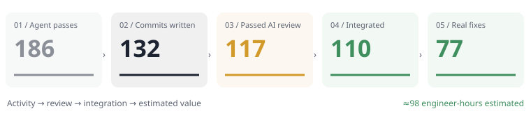
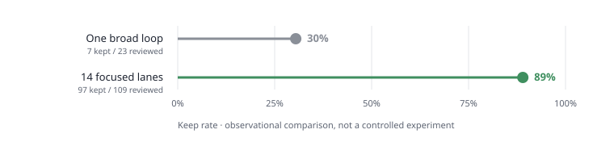
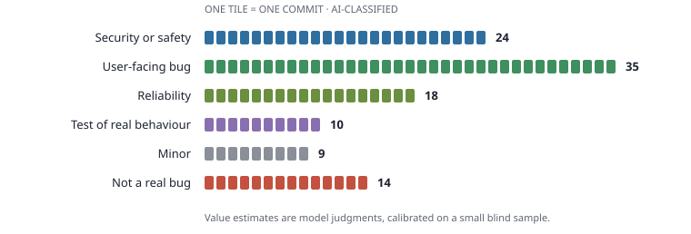
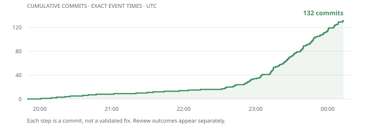
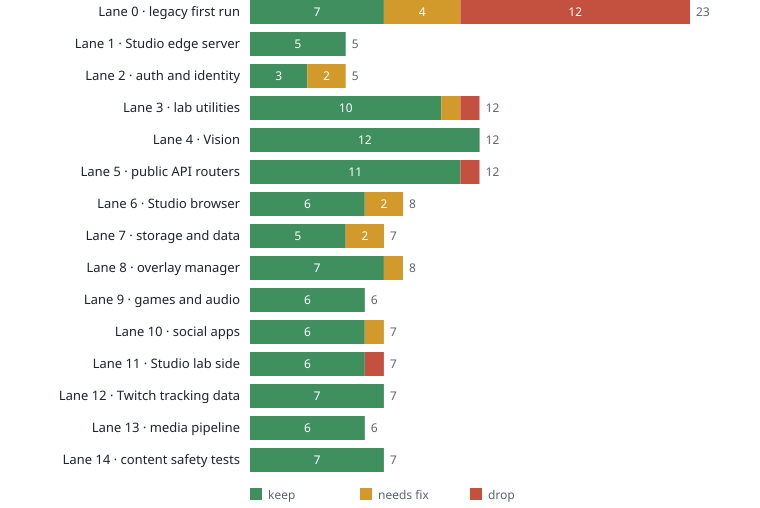

# Software Factory Technical Report

Software development with an unattended agent loop.

*Field report, 2026-10-26. Infected Research / FrackLabs*

| | |
|---|---|
| **848M** | tokens (95% cached reads) |
| **≈$493** | at list prices, all-in |
| **132** | commits written |
| **+3,761 / −905** | production lines, integrated |
| **110** | commits integrated, tests green |
| **77** | real bugs fixed (not minor) |
| **≈98 h** | senior-engineer time, est. |
| **14 · 4.5 h** | parallel agents · wall clock |

- **It made real value.** 77 genuine bug fixes (1 high, 31 medium, 45 low severity) survived review and the full test suite —
about 98 hours of senior-engineer work by our estimate — for ≈$493 of tokens (≈$6 per real fix).
- **Focus was the lever.** One broad agent loop had 30% of its commits kept. Fourteen narrowly scoped agents: 89%.
- **Review was the real work.** 13 commits needed fixing before they could merge; several would have shipped new bugs (one would have started logging passwords). About 1 in 7 claimed fixes weren't real bugs.

## What we did

We pointed 14 Grok 4.7 coding agents at our production codebase — Twitch AI agents, a streaming studio, overlays, auth, games, a public API — each confined
to one area, each on its own branch, looping *find one real bug → fix it with a test → commit* until the credits ran out. Instructions and policy prohibited deployment, secret access,
and editing their own rules. Then Claude Opus 5.5 reviewed every commit, we corrected accepted changes, merged the approved work onto current master, and ran the full test suite.

## Focus changed everything

The first run was one agent with a broad prompt. It drifted into busywork: "tests" that read source files as text, plus helper code only those tests used.
Splitting the work into narrow lanes with a stricter gate moved the keep rate from 30% to 89%.

## What the value is

Every integrated commit was classified (security, user-facing bug, reliability, test, minor), with a rough estimate of how long a senior engineer would need to find and fix it.
Against a blind spot-check by separate AI reviewers the classifier agreed on 10 of 11 classes and 9 of 11 "is this a real bug" calls, leaning slightly generous.
The biggest wins were in the overlay manager and stream services: refunded redeems that still played, a chat listener that died on one bad message, speech silently skipped.
Security-relevant fixes are counted here but described only by category until they are live.

## Where it went wrong

- **Overclaiming.** 14 of the 100 integrated fixes address something no real input can trigger, and 9 more are real but minor. Commit messages read like every change fixed a bug.
- **Fixes that break things.** The reviewer caught 13, several by running a repro: a 5-second full-table scan on every tip, a chat clipper that lost 100 of 101 messages, filter fixes that opened new bypasses.
- **Duplicate work.** A lane restarted fresh and re-fixed bugs the earlier run had already fixed (3 commits superseded).
- **Shared state.** Parallel fix agents used git's stash, which all worktrees share, and swapped each other's work. Nothing was lost, but forbid it.

## Throughput

186 passes; a commit-landing pass took about 8 minutes. 30M fresh and 629M cached tokens for writing
(≈$391), ≈$19 for the AI review, ≈$82 for supervision, integration and this write-up.
The agents wrote 15,982 lines; 11,339 survived into the integration branch, two-thirds of them tests.

## Verdicts per lane

Lane 0 is the first, broad run.

## Method, briefly

- Each lane: own git worktree and branch, a one-paragraph focus, one commit per pass, at most 300 production lines.
- External prompt, command-pattern policy and gate restrict deployment, service control, network commands, secrets and agent-behaviour files. These are workflow controls, not an OS sandbox.
- Per-pass gate: compile, forbidden paths, all Node tests and related Python tests, counting only failures that are new versus the base commit.
- Every 45 minutes: all lanes merged onto current master, full suite run, new failures bisected back to the lane that caused them.
- After the run: AI review of every commit, blind spot-check of a random sample, fixes, hand-resolved conflicts, full suite on the result. Criteria for "value" were written before the results were read.

## Caveats

- One night, one codebase, one writer model, no human control group. Value labels and hour estimates are AI judgements, calibrated on a small sample.
- The command-pattern policy does not prevent arbitrary code from accessing the host or network. Scoped-lane results are observational, not a randomized comparison.
- About 181 tests already fail without production secrets, so some areas were barely tested by the gate.
- Security findings are described by category only until fixed in production.
- Status: human sign-off **operator approved the high-risk brief (21 of 24 kept); other changes accepted on AI review, blind spot-check and suite comparison**; production **deployed 2026-10-27; live smoke checks passed; research analysis preliminary**. Value counts once it is live and not reverted.

## Production release and validation

**The approved release is deployed.** Production commit 9a5e6198f4f9;
Studio edge release 20261027T020402Z, 27 October 2026.
All 211 managed edge artifacts match the release.
The landing-page asset was hash-verified separately. All 40 supervised lab services,
plus clipper web and worker, restarted with new process IDs.

**Validation:** the final signed-off Python comparison found 181 baseline failures
and 174 candidate failures, with zero new failures. All 1,123 Node tests passed;
18 focused tests passed after merging two concurrent master commits; the ship gate also passed 28 browser smoke tests.
This is regression-relative validation, not a claim that every test passed.

**Live checks completed:**
- mobile/web OAuth handoff- authenticated Studio browser and chat UI- Studio identity canary- public landing/tracker/game pages- public API OpenAPI schema- synthetic follow alert visibly rendered through public overlay

**Initial sign-off exclusions:** the tips identity change and its partial performance fix;
the malformed-duration guard; and the screamhole audio refactor. The headline totals describe that initial release.

**Post-review remediation:** seven content-filter findings originally delivered as expected-failure tests
were fixed in 9b2e14b0 (378 related tests passed). The tips recipient defect was subsequently
approved, fixed with an indexed lookup and ambiguous-identity rejection, and deployed in 2b77f12b
(351 database/tips tests and 21 migration tests passed). The production index built in 36.2 seconds;
three read-only lookup samples took 14–20 ms. The lab stack was restarted after deployment.
These follow-up fixes are separate from the overnight accounting snapshot and initial-release value estimates.

**Startup observation:** username-history backfill held the SQLite writer lock briefly; completed; subsequent sampled service logs had no errors.

**Verification limits:**
- OAuth provider credential entry and chat message sending were not exercised- No git remote is configured; local master merged and production deployed

The analysis remains preliminary: value and engineer-hours are AI judgments, and token/cost totals reflect
the collected accounting snapshot rather than a continuously updated bill for subsequent report edits and rollout work.

## Addendum: every change

All 147 commits on the lane branches, oldest first per lane. "Not factory output" marks commits made before the loop started or by hand; they are listed for completeness and excluded from every number above. Value labels are AI estimates (see "What the value is"). Excluded patches are not automatically unresolved defects: some were refactors, duplicates, or unsupported bug claims. Follow-up outcomes are identified separately; the original review verdicts remain unchanged.

| Lane | Commit | Change | AI review | Outcome | Value |
|---|---|---|---|---|---|
| 0 | 3bd24f55 | Security/safety or high-risk change (category-only public record) | fix | included after fix · not factory output | — |
| 0 | ef335783 | nx: assert noindex on the editor and gallery responses (source grep could not see a wrong header) | keep | included · not factory output | — |
| 0 | 20445cca | relay: test the chat:relay-result payload (the source grep matched an unrelated clientId spread) | keep | included · not factory output | — |
| 0 | 23988442 | recap: render the stream recap card from a pure module (the test used to eval a slice of app.js) | keep | included · not factory output | — |
| 0 | b0afa352 | share: decide the share button and live flag in share-core (the test grepped app.js for IS_PWA) | drop | dropped in review · not factory output | — |
| 0 | dc7b1fd6 | reply: assert studio-reply-core load order on the script registry (index.html was grepped) | keep | included · not factory output | — |
| 0 | 4f2ab0dc | auth: restore dashboard scroll from a tested module (the template text was the only check) | keep | reverted in integration (broke an admin page test) · not factory output | — |
| 0 | 0a45f1b4 | Security/safety or high-risk change (category-only public record) | keep | included · not factory output | — |
| 0 | d22d5771 | chat: plan bang-command side effects before any request (app.js was grepped for the rules) | keep | included · not factory output | — |
| 0 | 90a052bc | account: paint auth identity before config from a tested choice (app.js call order was grepped) | drop | dropped in review · not factory output | — |
| 0 | 6fe7e57e | tests: lock overlay asset URLs, snapshot steps, and the dashboard scroll script (deploy coupling) | drop | dropped in review · not factory output | — |
| 0 | b2d1468d | moderation: cap deleted-message tombstones in the tested core (server dropped an untested half) | keep | included · not factory output | — |
| 0 | 2eacb93c | widgets: test that a throwing panel stays unmounted and hidden (it was untested) | drop | dropped in review · not factory output | — |
| 0 | 20283180 | Security/safety or high-risk change (category-only public record) | fix | included after fix · not factory output | — |
| 0 | b9fd7fdd | landing: test the hero picker by running it (home.js was eval'd from a source slice) | fix | included after fix | Test of real behaviour, low, not a real bug |
| 0 | 3788dfaf | moderation: decide surface wiring in the core (server.js was grepped for planDelete) | drop | dropped in review | — |
| 0 | 6ac7b25d | factory: serve the improvement board at /factory for admins (localhost was not reachable) | fix | excluded | — |
| 0 | b41dad27 | quote-game: join the public base in withBase (app.py was grepped for the string) | keep | included | Test of real behaviour, low, not a real bug |
| 0 | a82627a3 | hot-or-not: join the public base in withBase (app.py was grepped for the string) | fix | included after fix | Test of real behaviour, low, not a real bug |
| 0 | ad6a7969 | Security/safety or high-risk change (category-only public record) | fix | removed at human sign-off (no user-facing fix; touches the live OBS page) | Test of real behaviour, low, not a real bug |
| 0 | b0780d42 | boot: decide wiring markers in bootWiringFacts (app.js was grepped with match and indexOf) | drop | dropped in review | — |
| 0 | 543bb756 | emotes: decide picker chrome in emotePickerChromeFacts (styles.css was grepped) | drop | dropped in review | — |
| 0 | de2f209d | monitor: decide stack-monitor install in stack_monitor_deployment (unit files were grepped) | drop | dropped in review | — |
| 0 | 60bbb204 | studio: never read config during the auth paint (boot could throw when auth/status beat bootstrap) | keep | included · not factory output | — |
| 0 | a10417a0 | Security/safety or high-risk change (category-only public record) | drop | dropped in review | — |
| 0 | 746a8bda | hot-or-not: decide nightly backup coverage in hot_or_not_nightly_backup (backup script was grepped) | drop | dropped in review | — |
| 0 | b55a3bcb | outage-recovery: decide timer install in outage_recovery_deployment (unit files were grepped) | drop | dropped in review | — |
| 0 | 2d8da4be | audio: decide scenes HITL page wiring in scenes_hitl_page (templates were grepped) | drop | dropped in review | — |
| 0 | bc528706 | asr: decide test-webapp bind and text insertion in asr_test_page (source was grepped) | drop | dropped in review | — |
| 0 | a3ce2712 | Security/safety or high-risk change (category-only public record) | drop | dropped in review | — |
| 0 | e6f552b5 | soundboard: decide snapshot SEF upload in soundboard_snapshot_upload (backup script was grepped) | drop | dropped in review | — |
| 0 | 374511d1 | Security/safety or high-risk change (category-only public record) | drop | dropped in review | — |
| 0 | 30021c94 | Security/safety or high-risk change (category-only public record) | keep | included | Security or safety, low |
| 0 | c7788803 | rate-limit: do not record a denied attempt (a retry kept the block open) | keep | included | Reliability, low |
| 0 | cb5f655d | cookies: keep parsing when one value is not percent-encoded (a bad cookie 500'd auth) | keep | included | Reliability, medium |
| 0 | 29444a5a | Security/safety or high-risk change (category-only public record) | keep | included | Security or safety, high |
| 0 | 2cc86180 | Security/safety or high-risk change (category-only public record) | keep | included | Minor, medium, not a real bug |
| 0 | e19c378d | chat: drop clipped color codes and blank markup (a cut published hex garbage) | keep | included | User-facing bug, low |
| 1 | 4d9f16c6 | chat: drop length-capped color codes (they leaked hex into the message) | keep | superseded | — |
| 1 | 909c4e47 | chat: strip color codes before capping reply quotes (mobile showed the hex) | keep | superseded | — |
| 1 | d72f016d | private rooms: stop counting expired invites as active (the card lied) | keep | included | User-facing bug, low |
| 1 | d7dfa5e5 | private rooms: stop a max-length slug collision from hanging create (the suffix was sliced off) | keep | superseded | — |
| 1 | 7f48fdc0 | private rooms: reject an unparseable invite expiry instead of 500ing | keep | included | Minor, low, not a real bug |
| 2 | a9c1cca0 | Security/safety or high-risk change (category-only public record) | fix | included after fix | Security or safety, medium |
| 2 | acbbab57 | Security/safety or high-risk change (category-only public record) | fix | included after fix | Security or safety, medium |
| 2 | 4140c66f | Security/safety or high-risk change (category-only public record) | keep | included | Security or safety, medium |
| 2 | f09ef141 | Security/safety or high-risk change (category-only public record) | keep | included | Minor, low, not a real bug |
| 2 | 91e8ac71 | Security/safety or high-risk change (category-only public record) | keep | included | Security or safety, medium |
| 3 | dcfcd96a | offline queue: queue <@!id> mentions (bang form was dropped) | keep | included | User-facing bug, low |
| 3 | 36cdfe39 | db retry: retry SQLITE_LOCKED table locks (message omits "database is locked") | drop | dropped in review | — |
| 3 | d9e21c90 | Security/safety or high-risk change (category-only public record) | keep | included | Reliability, medium |
| 3 | 870fa2c5 | traffic alerts: gate property cold-start floor (mature baselines paged forever) | keep | included | Reliability, medium |
| 3 | e0eae208 | Security/safety or high-risk change (category-only public record) | keep | included | Reliability, medium |
| 3 | c1053815 | Security/safety or high-risk change (category-only public record) | keep | included | Reliability, medium |
| 3 | dff6bd66 | Security/safety or high-risk change (category-only public record) | keep | included | Security or safety, low |
| 3 | e2a4fc8a | Security/safety or high-risk change (category-only public record) | keep | included | Security or safety, low |
| 3 | c98b40aa | Security/safety or high-risk change (category-only public record) | fix | included after fix | Security or safety, low |
| 3 | c34e834d | Security/safety or high-risk change (category-only public record) | keep | included | Minor, low, not a real bug |
| 3 | f1ee4a1c | Security/safety or high-risk change (category-only public record) | keep | included | Security or safety, low |
| 3 | 3a09bd45 | Security/safety or high-risk change (category-only public record) | keep | included | Minor, low, not a real bug |
| 4 | eaeef7b0 | quote_game: reject malformed room settings and guesses (avoid 500s) | keep | included | Minor, low, not a real bug |
| 4 | 1b37c058 | quote_game: ignore unicode digits on practice routes (avoid 500s) | keep | included | Minor, low, not a real bug |
| 4 | 1278aa02 | quote_game: drop exclude ids SQLite cannot bind (avoid 500s) | keep | included | Minor, low, not a real bug |
| 4 | f89fc5d4 | soundboard: reject page offsets SQLite cannot bind (avoid 500s) | keep | included | Minor, low, not a real bug |
| 4 | 44f19c08 | tracker: reject list pages SQLite cannot bind (avoid 500s) | keep | included | Minor, low, not a real bug |
| 4 | d3fc3b64 | vision: let owners reopen archived collections (mine links 404'd) | keep | included | User-facing bug, medium |
| 4 | b9b34c0f | Security/safety or high-risk change (category-only public record) | keep | included | Security or safety, medium |
| 4 | 4fac3ad3 | Security/safety or high-risk change (category-only public record) | keep | included | Security or safety, low |
| 4 | 88a00ae8 | Security/safety or high-risk change (category-only public record) | keep | included | Security or safety, low |
| 4 | c0fac866 | Security/safety or high-risk change (category-only public record) | keep | included | Security or safety, medium |
| 4 | cc7c01e3 | vision: hide archived collections from photo uploads (replies confirmed the slug) | keep | included | Minor, low |
| 4 | 7912c0f2 | vision: hide archived collections from manage requests (403 confirmed the slug) | keep | included | Minor, low |
| 5 | cab51c3b | threads: keep fractional message page cursors (truncation skipped turns) | keep | included | User-facing bug, medium |
| 5 | 5a126be1 | threads: stabilize user message ids across restarts (hash() was salted) | keep | included | User-facing bug, medium |
| 5 | f9b69fb6 | Security/safety or high-risk change (category-only public record) | keep | included | Reliability, low |
| 5 | 77106044 | nx: reject blank bundle names (whitespace was stored as untitled) | keep | included | Minor, low |
| 5 | b3e67052 | spum-router: accept scores timed in raw seconds (rounded millis rejected real runs) | keep | included | User-facing bug, medium |
| 5 | ae9f618d | Security/safety or high-risk change (category-only public record) | keep | included | Security or safety, low |
| 5 | ec41b773 | Security/safety or high-risk change (category-only public record) | keep | included | Reliability, medium |
| 5 | a6f2b1a4 | nx: reject blank chat prompts (whitespace started a rewrite) | keep | included | Minor, low |
| 5 | 37ce2bb2 | threads: keep same-timestamp turns on a message page (exclusive cursor skipped them) | keep | included | User-facing bug, medium |
| 5 | 3f97c164 | studio: return 400 for invalid agent-room proposals (429 retried them) | drop | dropped in review | — |
| 5 | 41df532c | threads: reject blank http messages (socket already refused them) | keep | included | Minor, low |
| 5 | 0a343c1c | reports: reject blank resolutions (whitespace closed the report) | keep | included | Minor, low |
| 6 | 40e7958b | studio chat: ignore events from a replaced socket (late close dropped the live connection) | keep | included | User-facing bug, medium |
| 6 | 9f7b7de8 | Security/safety or high-risk change (category-only public record) | fix | included after fix | Security or safety, low |
| 6 | 8c00dfbc | agent room: keep proposals single-flight (Enter repeat queued a second copy) | fix | included after fix | User-facing bug, low |
| 6 | 5899ef37 | presence: keep the richer chatter when web and phone collapse (relay heartbeat wiped name and avatar) | keep | included | User-facing bug, low |
| 6 | a5eead9a | agent room: keep the throbber on the latest phase (elapsed tick restored the first snapshot) | keep | included | User-facing bug, low |
| 6 | fd50af48 | Security/safety or high-risk change (category-only public record) | keep | included | Security or safety, low |
| 6 | a21f07b8 | share: keep emoji whole when a title is truncated (slice split the surrogate pair) | keep | included | Minor, low |
| 6 | 3cd88f33 | agent room: unlock a propose when the socket drops (ack never arrives, composer stayed disabled) | keep | included | User-facing bug, low |
| 7 | ce0864cd | stream-memory: hold the cursor below undigested speech (budget and LLM errors skipped rows) | keep | included | Reliability, medium |
| 7 | 6c8fe3ff | stream-memory: keep over-cap rows behind the cursor (tail trim skipped the head) | fix | included after fix | Reliability, medium |
| 7 | 95f81374 | Security/safety or high-risk change (category-only public record) | keep | included | User-facing bug, low |
| 7 | 034c24d2 | Security/safety or high-risk change (category-only public record) | keep | included | Security or safety, low |
| 7 | 0e700d93 | live-watch: keep a poll error when no state row exists (first failure looked unchecked) | keep | included | User-facing bug, low |
| 7 | 06365d18 | Tips recipient identity and lookup performance | fix | initially held · indexed replacement deployed | Security or safety, medium |
| 7 | 34db1928 | Security/safety or high-risk change (category-only public record) | keep | included | Minor, low |
| 8 | 15b9ef51 | Security/safety or high-risk change (category-only public record) | keep | included | User-facing bug, low |
| 8 | 6482b0b0 | clipper: follow replay-chat cursors (offset step skipped the rest of a busy second) | fix | included after fix | Reliability, medium |
| 8 | 69a06130 | Security/safety or high-risk change (category-only public record) | keep | included | User-facing bug, medium |
| 8 | a34be77d | Security/safety or high-risk change (category-only public record) | keep | removed at human sign-off (no real producer sends the bad input) | Reliability, low |
| 8 | 981b9a38 | stream daemon: keep chat buffering after a bad inbox row (null username killed the listener) | keep | included | Reliability, medium |
| 8 | e6d317d3 | Security/safety or high-risk change (category-only public record) | keep | included | User-facing bug, medium |
| 8 | 7b62ec08 | Security/safety or high-risk change (category-only public record) | keep | included | Reliability, medium |
| 8 | 9151514d | Security/safety or high-risk change (category-only public record) | keep | included | User-facing bug, medium |
| 9 | bc711bb7 | Security/safety or high-risk change (category-only public record) | keep | included | Security or safety, low |
| 9 | 7eff7348 | audio: do not resurrect a discarded generation (late mark_ready) | keep | included | Reliability, low |
| 9 | da86f216 | hot_or_not: return skipped room photos to the pack (a skip is not a played round) | keep | included | User-facing bug, medium |
| 9 | 8546101a | Security/safety or high-risk change (category-only public record) | keep | included | Security or safety, medium |
| 9 | 757a9b6d | soundboard: keep a taken-down upload's file when the last active copy is deleted (restore would 404) | keep | included | Reliability, low |
| 9 | 22da1505 | hot_or_not: keep finished More Takes when a late failure arrives (slots 2 and 3 were deleted anyway) | keep | included | Reliability, low |
| 10 | 34056160 | messenger: refuse re-invite of a joined member (role rewrite) | keep | included | Minor, low, not a real bug |
| 10 | 65757d89 | Security/safety or high-risk change (category-only public record) | keep | included | Security or safety, low, not a real bug |
| 10 | 502bd15d | Security/safety or high-risk change (category-only public record) | keep | included | Security or safety, low |
| 10 | 98fc1472 | Security/safety or high-risk change (category-only public record) | fix | included after fix | Security or safety, low, not a real bug |
| 10 | 8aaa7014 | Security/safety or high-risk change (category-only public record) | keep | included | Security or safety, medium |
| 10 | 1a88e2e9 | Security/safety or high-risk change (category-only public record) | keep | included | Security or safety, low |
| 10 | 9224ca1a | Security/safety or high-risk change (category-only public record) | keep | included | Security or safety, low, not a real bug |
| 11 | 478f7508 | studio bridge: retry rate-limited Twitch relays on replay | drop | dropped in review | — |
| 11 | d774dd50 | studio db: reject older go-live noto claims (stale edge overwrote the live session) | keep | included | Reliability, low |
| 11 | 88ceaadf | Security/safety or high-risk change (category-only public record) | keep | included | Security or safety, medium |
| 11 | 1b19fc3c | studio nx: drop hermes edits cancelled mid-run (cancel still published the revision) | keep | included | User-facing bug, low |
| 11 | 802cdf14 | studio db: ignore older chat reaction snapshots (replay rewound emote counts) | keep | included | User-facing bug, low |
| 11 | cfd77296 | studio cli: list streamers by numeric twitch id (rename hid the channel) | keep | included | Minor, low |
| 11 | c4d092ec | studio db: scope chat replay to the current session (wrong clock key) | keep | included | User-facing bug, medium |
| 12 | 145331c4 | tracker: resolve reused Twitch logins to the latest channel (login is not identity) | keep | included | User-facing bug, low |
| 12 | 6f807293 | community: resolve reused Twitch logins to the latest channel (login is not identity) | keep | included | User-facing bug, low |
| 12 | 2be5c789 | tracker: keep numeric Twitch ids when a login is reused (canonical pages followed the alias) | keep | included | User-facing bug, low |
| 12 | 51a3aff8 | tracker: keep numeric Kick ids when a slug is reused (canonical pages followed the alias) | keep | included | User-facing bug, low |
| 12 | eab238c6 | tracker: pin search hits to numeric ids when an alias is reused (login is not identity) | keep | included | User-facing bug, low |
| 12 | 138353ac | tracker: page past a full rankings cache instead of skipping rows (lookahead is not the last page) | keep | included | User-facing bug, low |
| 12 | 6208b680 | tracker: rank unknown followers behind a real zero (pages follow the cache) | keep | included | User-facing bug, low |
| 13 | 64cb5f5b | sound_library: scale kHz note suffixes (2khz parsed as 2 Hz and bare hz crashed) | keep | included | User-facing bug, low |
| 13 | 981182ea | ytdownloader: parse Imgur ids after tag routes (prefix was used as the id) | keep | included | User-facing bug, low |
| 13 | 12fc12a2 | ytdownloader: download direct Imgur mp4 and gifv (image gate rejected them) | keep | included | User-facing bug, low |
| 13 | 7cd5e02c | sound_library: parse A440 as concert pitch (octave 440 silenced the render) | keep | included | User-facing bug, low |
| 13 | 922321f4 | sound_library: parse timing unit suffixes (bare float crashed the render) | keep | included | Reliability, low |
| 13 | 1b1cfd2c | clipper: accept mobile Twitch VOD URLs (m.twitch.tv was rejected) | keep | included | User-facing bug, low |
| 14 | cccb5054 | tos-filter: pin letters-only stem hits (spaces were joining ordinary words) | keep | included · findings fixed and deployed in follow-up | Test of real behaviour, medium, not a real bug |
| 14 | 455ab45d | tos-filter: pin l33t stems glued to the next word (digits never reach the stem scan) | keep | included · findings fixed and deployed in follow-up | Test of real behaviour, medium, not a real bug |
| 14 | 877595d2 | tos-filter: pin slash form of the 14/88 hate code (regex only allows whitespace) | keep | included · findings fixed and deployed in follow-up | Test of real behaviour, low, not a real bug |
| 14 | d48f8533 | tos-filter: pin dot, underscore, and slash forms of preteen and underage (separator class is only hyphen or space) | keep | included · findings fixed and deployed in follow-up | Test of real behaviour, medium, not a real bug |
| 14 | 48c97251 | tos-filter: pin hyphen and slash forms of numeric age phrases (age rules only accept whitespace) | keep | included · findings fixed and deployed in follow-up | Test of real behaviour, medium, not a real bug |
| 14 | f92788cd | tos-filter: pin determiner forms of minor-plus-clothing phrases (in+garment allows no word between) | keep | included · findings fixed and deployed in follow-up | Test of real behaviour, medium, not a real bug |
| 14 | e0e629c1 | tos-filter: pin plural forms of sexualized-minor phrases (minor-word list is singular only) | keep | included · findings fixed and deployed in follow-up | Test of real behaviour, medium, not a real bug |

